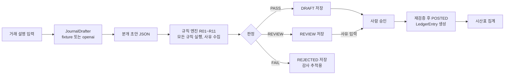

# ledger-guard (전표지기)

거래 설명을 받아 분개 초안을 만들고, 규칙 엔진이 차대평형, 부가세, 계정과목, 세금계산서 요건, 기간 마감을 판정해 PASS, REVIEW, FAIL과 사유를 돌려주는 소규모 회계 전표 검증 API입니다. 사람이 승인한 전표만 원장에 전기되고 시산표로 집계됩니다.

초안은 "해석", 판정과 계산은 "규칙 코드"가 맡습니다. 초안을 만드는 쪽이 LLM이든 고정 데이터든 판정 결과는 같은 규칙 코드와 같은 골든셋으로 검증됩니다.

## 왜 만들었나

세무 전공자로서 회계 전표의 판정 기준을 코드와 테스트로 옮겨 보고 싶었습니다. ERP에서 전표는 차변과 대변이 맞아야 하고, 부가세는 공급가액의 10%에서 원 미만을 버린 값이어야 하며, 세금계산서에는 사업자등록번호 같은 기재사항이 있어야 합니다. 이런 기준은 문서에는 있지만 코드로 고정되어 있지 않은 경우가 많습니다.

LLM이 분개 초안을 만들어 주는 흐름이 늘고 있지만, 초안을 그대로 믿을 수는 없습니다. 면세 거래에 부가세를 붙이거나, 부가세를 반올림하거나, 없는 계정과목을 쓰는 실수가 흔합니다. 이 프로젝트는 초안이 어디서 오든 같은 규칙으로 판정하고, 판정이 맞는지 골든셋으로 측정하는 구조를 만든 것입니다.

## 동작 흐름



## 실행

Docker Desktop이 켜져 있으면 한 줄로 실행합니다. PostgreSQL 16 컨테이너가 먼저 뜨고, 앱은 DB가 healthy가 된 뒤에 시작합니다.

```bash
docker compose up --build -d
bash scripts/smoke.sh        # 초안 -> 저장 -> 승인 -> 시산표 흐름을 curl로 보낸다
docker compose down -v
```

Swagger UI는 [http://localhost:8080/swagger-ui.html](http://localhost:8080/swagger-ui.html)에서 열립니다. 호스트 포트를 바꾸려면 `APP_PORT=18080 docker compose up -d`처럼 지정합니다.

로컬 Gradle로 실행하려면 PostgreSQL이 필요합니다. `.env.example`의 변수 이름을 참고해 접속 정보를 환경변수로 넘깁니다.

```bash
SPRING_DATASOURCE_URL=jdbc:postgresql://localhost:5432/ledger \
SPRING_DATASOURCE_USERNAME=ledger SPRING_DATASOURCE_PASSWORD=ledger \
./gradlew bootRun
```

테스트는 DB 없이 H2(PostgreSQL 모드)로 돌아갑니다.

```bash
./gradlew test
```

## API 요약

| 메서드와 경로 | 설명 |
|---|---|
| `GET /api/accounts` | 계정과목표 30개 |
| `POST /api/vouchers/draft` | 거래 설명으로 초안 생성과 판정. 저장하지 않음. 응답 `drafter` 필드가 `fixture`이면 실제 LLM 호출이 아님 |
| `POST /api/vouchers` | 전표 저장. 판정 결과에 따라 DRAFT, REVIEW, REJECTED. FAIL도 기록으로 남김 |
| `GET /api/vouchers/{id}`, `GET /api/vouchers?status=&month=` | 조회와 목록 |
| `POST /api/vouchers/{id}/approve` | 재검증 뒤 승인과 전기. FAIL은 409, REVIEW는 사유가 없으면 409 |
| `POST /api/periods/{yyyymm}/close` | 기간 마감 |
| `GET /api/reports/trial-balance?month=2026-10` | 월별 합계잔액시산표. `balanced` 필드로 총차변과 총대변 일치 여부 표시 |
| `/actuator/health`, `/actuator/health/readiness`, `/actuator/health/liveness` | 상태 확인 |

요청과 응답 예시는 [docs/api.md](docs/api.md)에 있습니다.

## 규칙

규칙은 `ValidationRule` 인터페이스를 구현한 독립 클래스 11개입니다. 엔진은 코드 순으로 모든 규칙을 끝까지 실행해 사유를 전부 모으고, FAIL이 하나라도 있으면 FAIL, 없고 REVIEW가 있으면 REVIEW, 둘 다 없으면 PASS로 판정합니다.

| 코드 | 이름 | 판정 | 내용 | 근거 |
|---|---|---|---|---|
| R01 | BALANCED | FAIL | 차변 합계와 대변 합계가 같아야 함 | 복식부기 대차평균의 원리 |
| R02 | ACCOUNT_VALID | FAIL | 모든 라인의 계정코드가 계정과목표에 있고 사용 중이어야 함 | 계정과목표 |
| R03 | AMOUNT_POSITIVE_INT | FAIL | 라인 금액은 1원 이상의 정수. 0, 음수, 소수 금지 | 원 단위 기록 |
| R04 | VAT_AMOUNT | FAIL | 과세 거래의 부가세 라인 합계는 공급가액의 10%에서 원 미만을 버린 값. 면세, 영세율, 부가세 대상 아님 거래에는 부가세 라인 없어야 함 | 부가가치세법 제30조. 원 미만 버림은 국고금관리법 제47조(확인 필요) |
| R05 | VAT_ACCOUNT_SIDE | FAIL | 매입 거래의 부가세는 부가세대급금 차변, 매출 거래의 부가세는 부가세예수금 대변 | 부가가치세법 제37조(확인 필요) |
| R06 | TAX_INVOICE_REQUISITES | FAIL | 세금계산서 증빙이면 사업자등록번호 10자리와 체크섬, 과세이면 공급가액과 세액 라인 분리 | 부가가치세법 제32조 제1항(확인 필요) |
| R07 | PERIOD_OPEN | FAIL | 전표 일자가 속한 월이 마감되어 있으면 안 됨 | 회계기간 마감 |
| R08 | DATE_NOT_FUTURE | FAIL | 전표 일자가 오늘보다 미래이면 안 됨 | 발생주의 |
| R09 | ENTERTAINMENT_EVIDENCE | REVIEW | 기업업무추진비 3만원 초과인데 증빙이 없으면 검토 | 법인세법 제25조 제2항, 시행령 제41조(확인 필요) |
| R10 | DUPLICATE_SUSPECT | REVIEW | 같은 일자, 거래처, 총액의 전표가 이미 있으면 검토 | 이중 기표 방지 |
| R11 | DRAFT_SCHEMA | FAIL | 초안 단계에서 라인 2개 이상, 필수 필드 확인. 초안 생성 실패도 여기서 FAIL | 초안 스키마 |

규칙별 입력, 판정, 예시는 [docs/rules.md](docs/rules.md)에 있습니다. 세법 조문 번호는 작성자가 다시 확인해야 하며, 확신이 없는 곳은 "확인 필요"로 표시했습니다.

## 검증

2026년 10월 11일 로컬(macOS, Temurin 21.0.11, Gradle 9.6.1 Wrapper)에서 `./gradlew test`를 실행해 테스트 100개가 모두 통과했습니다. 규칙 단위 테스트 56개, 사업자등록번호 체크섬 13개, 엔진 5개, fixture 작성기 7개, OpenAI 작성기(모의 서버) 6개, 작성기 선택 1개, API 통합 테스트 8개, 골든셋 평가 3개, 컨텍스트 로딩 1개입니다.

골든셋 평가 결과는 아래와 같습니다. 재현 명령과 상세 표는 [docs/evaluation.md](docs/evaluation.md)에 있습니다.

| 세트 | 건수 | 결과 |
|---|---|---|
| 올바른 전표 `valid_vouchers.json` | 27 | PASS 27건, 거짓 양성 0건 |
| 결함 전표 `faulty_vouchers.json` | 26 | 기대 코드 전부 검출 26건, 검출 코드가 기대와 정확히 일치 26건 |
| 규칙이 못 잡는 결함 `semantic_misses.json` | 5 | PASS 5건. 차대와 계정 유효성은 맞지만 계정 선택이 틀린 전표를 현재 규칙은 통과시킨다 |

같은 날 `docker compose up --build -d`로 PostgreSQL 16.15와 앱을 띄우고 `scripts/smoke.sh`로 초안 생성, 저장(id 1, DRAFT), 승인(POSTED), 차대 불일치 전표 저장(id 2, REJECTED)과 승인 시도(HTTP 409), 시산표(총차변 110,000원, 총대변 110,000원, balanced true)를 확인했습니다. Flyway 마이그레이션 2개가 PostgreSQL에 적용되었고 계정과목 30건이 들어갔습니다.

`kubectl apply --dry-run=client --validate=false -f k8s/`는 kubectl v1.36.3에서 통과했습니다(Deployment, Service 2개, ConfigMap, StatefulSet, Secret). 실제 클러스터에는 배포하지 않았으므로 K8s 매니페스트는 문법과 구조만 확인한 상태입니다.

GitHub Actions는 push와 PR마다 `./gradlew test`와 `docker build`를 실행합니다. 첫 실행은 Linux의 시각 정밀도 차이로 실패했고 수정 뒤 [통과했습니다](https://github.com/aeginventor/ledger-guard/actions/runs/38120768628). 전체 목록은 [Actions](https://github.com/aeginventor/ledger-guard/actions)에 있습니다.

## 한계와 다음 작업

- 실제 LLM을 호출하지 않았습니다. 기본 작성기는 `src/main/resources/drafts/*.json`의 고정 초안을 거래 설명 키워드로 고르는 fixture입니다. OpenAI 작성기는 `OPENAI_API_KEY`가 있을 때만 활성화되며 이번 작업에서는 키가 없어 호출하지 않았습니다.
- 규칙은 형식과 금액만 봅니다. 비품 구입을 소모품비로 적거나 매출을 잡이익으로 적은 전표는 통과합니다. 이 한계는 `semantic_misses.json` 5건과 테스트로 고정해 두었습니다.
- 기업업무추진비처럼 매입세액이 공제되지 않는 거래는 자동으로 가려내지 않습니다. 총액을 비용으로 적고 `vatType`을 `NA`로 두는 방식으로만 표현할 수 있습니다.
- 세법 조문 번호는 작성자가 직접 확인해야 합니다. 확신이 없는 곳은 코드와 문서에 "확인 필요"로 표시했습니다.
- 단일 사용자 전제이며 인증과 권한이 없습니다. 승인자 이름은 요청 본문의 문자열일 뿐입니다.
- 시산표는 해당 월에 전기된 원장 항목만 집계합니다. 이월 잔액과 누적 잔액은 다루지 않습니다.
- 전표 수정과 삭제, 역분개, 다중 통화, 결산 분개는 없습니다.
- 테스트는 H2를 PostgreSQL 모드로 사용합니다. PostgreSQL 고유 동작은 compose 실행으로만 확인했습니다.

## 작업 문서

- [규칙 상세](docs/rules.md)
- [설계 결정 로그](docs/decisions.md)
- [골든셋 평가 결과와 재현 명령](docs/evaluation.md)
- [계층 구조와 ERD](docs/architecture.md)
- [API 예시](docs/api.md)

## AI 코딩 도구 사용 범위

이 저장소의 구현 코드와 테스트 코드는 AI 코딩 도구가 작성했습니다. 요구사항 정의, 규칙 선정, 판정 기준, 한계 정의는 작성자(김산)가 검토하는 구조입니다. 작성자가 아직 검토하지 않은 설계 결정은 [docs/decisions.md](docs/decisions.md)에서 "사용자 확인 필요: 예"로 표시된 항목으로 알 수 있습니다. 작성자가 직접 구현했다고 적지 않습니다.
