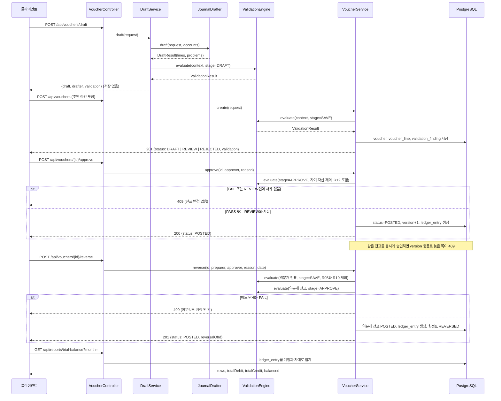
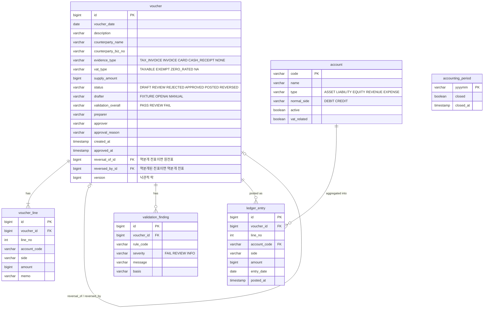

# 계층 구조와 요청 흐름

Spring Boot 3.5, Java 21, Spring Data JPA, Flyway, PostgreSQL 16(테스트는 H2 PostgreSQL 모드)입니다. 패키지는 기능 단위로 나눴고 규칙 엔진은 JPA에 의존하지 않습니다.

```
io.github.aeginventor.ledgerguard
├── account      계정과목 엔티티, 리포지토리, 조회 API
├── voucher      전표, 라인, 검증 사유 엔티티와 저장, 승인 서비스와 API
├── validation   VoucherData, ValidationContext, ValidationRule, ValidationEngine, ValidationMetrics, 사업자등록번호 체크섬
│   └── rules    R01 ~ R13 독립 규칙 클래스
├── draft        JournalDrafter 인터페이스, FixtureJournalDrafter, OpenAiJournalDrafter, DraftService
├── period       회계기간 마감
├── ledger       원장 엔티티와 집계 쿼리
├── report       시산표 서비스와 API
└── common       예외 처리, Clock, OpenAPI 설정
```

## 요청 흐름



## 규칙 엔진

`ValidationEngine`은 Spring이 모은 `ValidationRule` 빈을 코드 순으로 정렬해 모두 실행합니다. 규칙은 `ValidationContext`만 보고 판정하며, 컨텍스트의 외부 조회(계정과목, 기간 마감, 중복)는 함수로 주입됩니다. 그래서 규칙 단위 테스트는 DB 없이 돌고, 골든셋 평가는 Flyway 시드 계정과 JSON의 setup(오늘 날짜, 마감 기간, 기존 전표)으로 환경을 고정합니다.

`ValidationContextFactory`가 실제 서비스에서 리포지토리와 `Clock`을 감싸 컨텍스트를 만듭니다. 승인 단계에는 승인자 이름이 컨텍스트에 들어가 R12가 작성자와 비교합니다. 판정 결과는 `ValidationMetrics`가 Prometheus 카운터로 남깁니다.

## 테이블



`voucher_line.account_code`는 일부러 외래키를 걸지 않았습니다. 없는 계정코드가 들어온 전표도 REJECTED로 저장해 사유를 남겨야 하기 때문입니다. `ledger_entry.account_code`는 승인된 전표만 들어가므로 외래키를 겁니다.

## 배포 구성

- `Dockerfile`: 1단계 `eclipse-temurin:21-jdk`에서 Gradle Wrapper로 bootJar 생성(테스트 제외), 2단계 `eclipse-temurin:21-jre`에 jar와 curl만 복사. 비루트 사용자로 실행
- `docker-compose.yml`: `postgres:16-alpine`과 앱. DB는 `pg_isready` healthcheck, 앱은 DB가 healthy가 된 뒤 시작하고 `/actuator/health/readiness`로 healthcheck
- `k8s/`: ConfigMap(접속 URL, 작성기, 시간대), Secret 예시, PostgreSQL StatefulSet과 headless Service, 앱 Deployment(readiness와 liveness 프로브, 리소스 요청과 제한, 비루트 UID 10001), ClusterIP Service. kind 클러스터 실측 결과는 [evaluation.md](evaluation.md)
